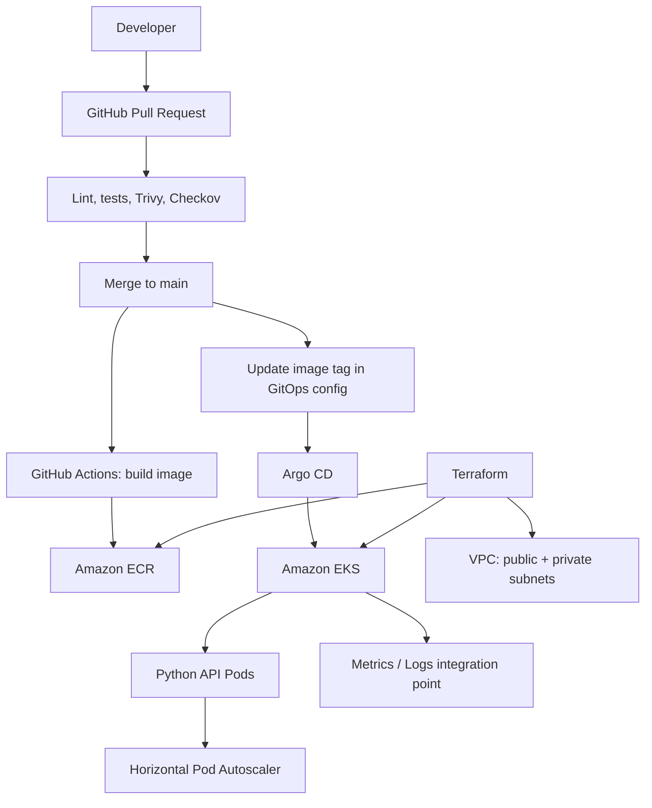

# Enterprise AWS EKS Platform

A production-style, portfolio-grade platform engineering project that provisions an AWS EKS foundation with Terraform and deploys a containerized Python service using GitHub Actions, Amazon ECR, Helm and Argo CD.
[](https://github.com/fastlanegaurav/enterprise-aws-eks-platform/actions/workflows/ci.yml)

[](https://github.com/fastlanegaurav/enterprise-aws-eks-platform/actions/workflows/image-publish.yml)

[](https://github.com/fastlanegaurav/enterprise-aws-eks-platform/actions/workflows/terraform-security.yml)

> **Important:** This is an engineering reference implementation, not a claim of production certification. Review the security, networking, version compatibility and cost settings for your environment before applying it.

## What this demonstrates

- AWS networking with public/private subnets and NAT
- Managed Amazon EKS cluster and managed node group
- Terraform infrastructure as code
- GitHub Actions CI/CD with AWS OIDC (no long-lived AWS keys)
- Container build, vulnerability scanning and Amazon ECR publishing
- Kubernetes health probes, resource requests/limits, HPA and PodDisruptionBudget
- Helm packaging and Argo CD GitOps deployment
- Operational runbooks and verification steps

## Architecture



## Repository layout

```text
.
├── app/                       # Example Python API
├── helm/platform-api/         # Helm chart
├── argocd/                    # Argo CD Application
├── terraform/                 # AWS VPC, EKS and ECR
├── .github/workflows/         # CI, image build and Terraform checks
├── docs/                      # Architecture and operations
└── Makefile
```

## Prerequisites

- AWS account with permissions to create VPC, EKS, IAM, EC2 and ECR resources
- Terraform >= 1.6
- AWS CLI v2
- kubectl compatible with your EKS Kubernetes version
- Helm 3
- Docker
- An AWS region with EKS capacity

## Quick start: local application

```bash
cd app
python -m venv .venv
source .venv/bin/activate
pip install -r requirements.txt
pytest -q
python app.py
```

Open `http://127.0.0.1:8080/health` and `http://127.0.0.1:8080/`.

## Provision AWS infrastructure

1. Review `terraform/terraform.tfvars.example`.
2. Copy it to `terraform/terraform.tfvars` and set unique values.
3. Restrict `cluster_endpoint_public_access_cidrs` to your current public IP `/32`, or use a private connectivity path and disable public access.
4. Configure remote state before team use. The example uses local state to keep the starter reproducible.
5. Run:

```bash
cd terraform
terraform init
terraform fmt -check
terraform validate
terraform plan
terraform apply
```

Get cluster credentials:

```bash
aws eks update-kubeconfig --region <region> --name <cluster-name>
kubectl get nodes
```

## Deploy with Helm

```bash
helm upgrade --install platform-api ./helm/platform-api \
  --namespace platform --create-namespace \
  --set image.repository=<account-id>.dkr.ecr.<region>.amazonaws.com/platform-api \
  --set image.tag=<tag>
```

For a quick smoke test without a load balancer:

```bash
kubectl -n platform port-forward svc/platform-api 8080:80
curl http://127.0.0.1:8080/health
```

## GitOps with Argo CD

Install Argo CD using its official installation instructions, then update `argocd/platform-api.yaml` with:
- Your Git repository URL
- The branch or immutable revision you want Argo CD to track
- The correct chart path

Apply it:

```bash
kubectl apply -f argocd/platform-api.yaml
```

The chart's default image is a placeholder. Set a real ECR repository and tag in the Argo CD Application Helm values or use a committed values file. Do not store credentials in Git.

## GitHub Actions setup

The workflows include pull-request validation and a container build/push workflow. Before enabling AWS publishing:

1. Create an IAM role for GitHub Actions using GitHub's OIDC provider.
2. Restrict the role trust policy to this exact repository and branch/environment.
3. Grant only the ECR permissions required by the workflow.
4. Add repository variables:
   - `AWS_REGION`
   - `AWS_ROLE_ARN` (repository variable)
   - `ECR_REPOSITORY`
5. Ensure the ECR repository exists (Terraform creates it).
6. Enable the workflow after reviewing its permissions.

The workflow intentionally does not configure a wide-open EKS API endpoint or automatically grant deployment permissions. For cluster deployment from GitHub-hosted runners, use a secure network path (such as a self-hosted runner inside the VPC) or carefully restrict the cluster endpoint CIDRs.

## Security design decisions

- GitHub Actions uses OIDC rather than static AWS access keys.
- EKS API public access should be restricted to trusted CIDRs; private access is preferred.
- Kubernetes containers run as non-root and drop Linux capabilities.
- The chart defines CPU/memory requests and limits, health probes, HPA and PDB.
- Trivy scans the built image; Checkov scans Terraform.
- Never commit `.tfstate`, plan files, kubeconfig, AWS credentials, `.env` files or secrets.

## Cost warning

EKS has a cluster control-plane charge, in addition to EC2 worker nodes, NAT Gateway, load balancers, EBS and data transfer. This project can incur ongoing charges even when the application is idle. Use a disposable development environment, inspect the AWS Pricing Calculator, and run `terraform destroy` when finished. NAT Gateway and load balancers can be material cost drivers.

## Cleanup

```bash
cd terraform
terraform destroy
```

Delete any separately installed Argo CD resources and manually created OIDC IAM roles if they are not managed by this Terraform configuration. Confirm ECR images and other retained resources before closing the account/project.

## Evidence to add before putting this on your resume

- Terraform plan/apply output with account IDs redacted
- `kubectl get nodes,pods,svc -A` output
- GitHub Actions successful run screenshot
- Trivy scan summary
- Grafana dashboard screenshot if you deploy monitoring
- A short demo showing a commit moving through CI, ECR and Argo CD
- Measured test results (deployment duration, pod recovery, HPA scaling); do not invent metrics

## Suggested resume bullet (only after you implement and verify)

Designed a Terraform-based AWS EKS platform with private worker nodes, managed node groups, ECR image publishing, GitHub Actions OIDC, Helm deployments and Argo CD GitOps; added Kubernetes health probes, autoscaling, disruption budgets and container security scanning.
